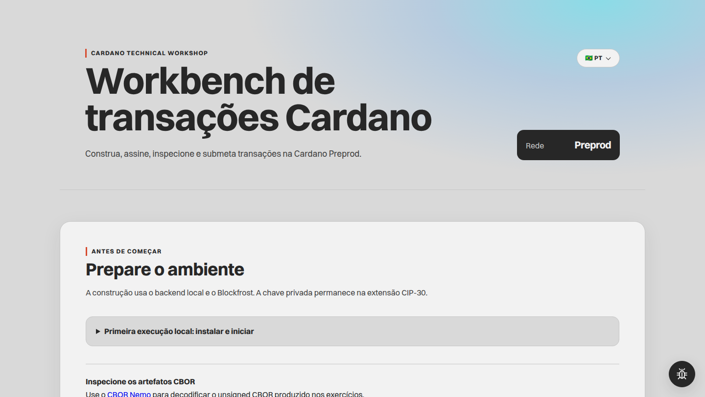

# cardano-technical-workshop

[Versão em português](README.md)

Full-stack TypeScript Workbench for building Cardano transactions through an API and signing with a CIP-30 wallet. A static deployment adaptation runs the same Cardano logic in the browser.



The custody boundary is explicit:

- in full-stack mode, the API queries Cardano Preprod, builds transactions, and submits them through Blockfrost;
- in static mode, the browser performs those operations with the same builders and validators;
- the CIP-30 extension signs in the browser without exposing the private key;
- the Workbench validates and displays unsigned CBOR, witnesses, signed CBOR, transaction hash, and block inclusion.

## Requirements

- Node.js 20.19.0 or newer for development, builds, and the API; the published static site does not require Node on the client;
- Google Chrome or Chromium available as `google-chrome` or through `CHROME_BIN`, plus `gio` to discard the browser smoke test's temporary profile;
- a Blockfrost project on Cardano Preprod;
- a CIP-30 wallet configured for Preprod;
- tADA in at least one UTxO of the wallet used to build transactions;
- a second wallet with a different payment key for the multisig exercise.

The CIP-30 network identifier distinguishes mainnet from testnet, but does not distinguish Preprod from Preview. You must confirm the Preprod selection in the extension.

## Full-stack development

This is the default mode and the path explained in the [facilitation guide](passoapasso.en.md).

```bash
npm ci
cp .env.example .env
# Configure a Blockfrost Preprod project in .env.
npm run dev
```

The `dev`, `server`, `start`, and `address` scripts load the root `.env` through Node, without shell setup commands. Create the file before running them. Variables already set in the environment take precedence over the file.

Open <http://127.0.0.1:5173>. The command starts the Vite frontend and Express API, available at <http://127.0.0.1:8787/api/health>. Vite proxies `/api` to the backend. `BLOCKFROST_PROJECT_ID` remains in the server environment; the frontend does not request, read, or send a browser Blockfrost key in this mode. The API never receives the wallet seed or private key.

The adapters in `apps/web/src/workshop.ts` preserve the same interface contract. Full-stack mode calls the routes in `apps/api/src/server.ts`; static mode calls the builders and validators in `packages/cardano/` directly. Mode selection happens at build time, without automatic fallback between modes.

## Deployment

### Full-stack

```bash
npm run build
npm run server
```

With `.env` configured, Express serves the frontend from `dist/` and the `/api` routes on the same origin. The default bind is `127.0.0.1:8787`; use an HTTPS proxy for external access. Before exposing a public API, configure access controls and rate limits to protect the Blockfrost quota. Do not publish `.env` or seed files. If the host injects variables without an `.env` file, start with `node --import tsx apps/api/src/server.ts`.

### Static

```bash
npm run build:static
```

Publish **only `dist-static/`** to Vercel, GitHub Pages or another static host. This directory is separate from `dist/`, so one build cannot replace the other. Assets use relative URLs and support subdirectory hosting. No application backend or build secret is needed. Use `npm run dev:static` for development in this mode.

On the static site, choose **API key** and enter your own Blockfrost Preprod key. It is stored unencrypted in this origin’s `localStorage` and sent as a header to the fixed Preprod endpoint. Scripts on this origin can read it. Do not use a shared CF credential, and remove the key on shared devices. The prompt supports replacement; empty input removes the key, while Cancel preserves it. Changing it preserves artifacts and repeats readiness checks.

Never enter a wallet seed phrase or private key. Network operations still require internet access; static deployment does not mean offline operation.

[CBOR Nemo](https://cbor.nemo157.com/) is a third-party inspection tool. Prefer unsigned CBOR. Never send it a seed phrase, private key or Blockfrost credential; anyone holding valid signed CBOR may submit it.

## Participant-led format

The Workbench is the authoritative operational guide. After a short introduction, participants should be able to:

1. verify Blockfrost, wallet, network, and balance;
2. understand the objective, inputs, expected output, and effect of each exercise;
3. follow only the next enabled action;
4. recognize build, signature, merge, submission, and inclusion;
5. correct an error and retry without losing the last valid checkpoint;
6. reset only the current exercise;
7. restore fields and preserved artifacts in the same tab;
8. inspect the real source excerpt for each step.

The session uses `sessionStorage`. It preserves addresses, CBOR, and witnesses in the current tab, but never stores the private key or CIP-30 object. After a page reload, the wallet must be connected again. The script address and multisig setup UTxO list are not persisted. Generate, review, and select this data again before a new lock or unlock.

## Language

The in-product `Language` selector switches the Workbench between Brazilian Portuguese and English without reloading the page. Brazilian Portuguese (`pt-BR`) is the default, regardless of the browser language. The explicit preference is stored separately in `localStorage` under `cardano-technical-workshop.locale.v1`, while transaction inputs, progress, and artifacts remain in `sessionStorage` under `cardano-technical-workshop.session.v1`.

Changing the language updates visible copy, accessible names, announcements, locale-sensitive formatting, `html.lang`, and structured errors. In full-stack mode, requests send `Accept-Language` and the API returns `Content-Language` and message references; static mode localizes messages in the browser.

The switch does not rebuild, sign, merge, submit, reset, or otherwise alter transaction state, session state, input values, artifacts, or wallet authorization. A reload restores the language preference and preserved transaction session independently, but the CIP-30 wallet remains disconnected until the participant authorizes it again.

## Exercises

1. Simple payment.
2. Payment with metadata under label 674.
3. 2-of-2 multisig, with lock, UTxO selection, CBOR handoff, and unlock.
4. Native Asset in two examples:
   - 4A: training issuance of `EAC-WORKSHOP-001`, partial retirement by burn, and raw metadata under private-use label `65536`;
   - 4B: media token with CIP-25 presentation metadata under label `721`.

Every exercise begins with Objective, Completion condition, and Submission effect, always in that order.

Each full-stack pipeline follows this contract. In static mode, the browser performs the operations assigned to the API:

```text
API builds unsigned tx
CIP-30 wallet produces witness
browser validates and attaches witness
participant reviews the effect
API submits signed tx to Blockfrost
Workbench verifies inclusion on Preprod
```

Each step card provides `Show code`. The dialog identifies the exercise, step, file, and line range and displays an excerpt extracted from the current source with TypeScript syntax highlighting. Clean builds link the excerpt to the exact Git commit. With uncommitted local changes, the path remains visible but does not receive a remote link that would represent different code. Opening or closing it does not alter inputs, progress, artifacts, or session state.

The hash is deterministic and can be calculated locally before submission. A successful Blockfrost response confirms acceptance for submission. If the response is lost, the Workbench preserves the hash as `unknown result`, allows an inclusion check, and only repeats submission through an explicit action. A `404` from the check means only that Blockfrost has not indexed the hash yet. It confirms neither rejection nor acceptance. The exercise shows completion only after Blockfrost reports inclusion in a block. This inclusion must not be described as irreversible finality.

## Effects on Preprod

- Payment transfers tADA and pays a fee.
- Metadata transfers tADA and publishes content visible on the blockchain.
- Multisig lock moves tADA to a script that requires two distinct keys. An incorrect configuration may make the balance inaccessible.
- Multisig unlock consumes the selected UTxO, sends the specified value to the destination, and returns change to the script. Inclusion completes one round, not recovery of the entire balance. To move the remainder, reset the unlock, list the new UTxO, and repeat with both wallets.
- The EAC example creates `1000000` synthetic base units of `EAC-WORKSHOP-001`. With `decimals: 3`, the Workbench displays `1,000.000 EAC`. This display convention does not change the integer quantity recorded in the ledger. The balance remains in the connected wallet.
- Issuance attaches `methodology_hash`, `assurance_hash`, and `evidence_root` under label `65536`. Retirement burns `125000` base units, keeps `875000` in the output, and attaches `declaration_hash` and `delivery_reference_hash` under the same label. All hashes are synthetic. A private-use label does not make the data confidential.
- The EAC policy is stable and requires the wallet key. It does not validate metadata, limit supply, or verify external claims. The approximately three-hour validity belongs to each built transaction, not to the policy.
- The CIP-25 example creates units of a media token, uses at least 5 tADA in the output, and has a policy valid for approximately three hours.

Use disposable wallets and testnet values during validation.

## Supporting CLI

The separate Node CLI reads `CARDANO_NETWORK=preprod`, `BLOCKFROST_PROJECT_ID` and, for signing, `.seedphrase` or `WALLET_MNEMONIC`. Configure these in the local `.env` based on `.env.example`; the CLI scripts load the file automatically. Never publish these credentials. The browser app does not import this filesystem/seed code.

```bash
npm run start -- address
npm run start -- send-ada addr_test... 100000000
npm run start -- build-cbor addr_test... 100000000
npm run start -- build-cbor-metadata addr_test... 100000000 "Hello, Cardano!"
npm run start -- multisig-info second_signer_addr_test...
npm run start -- lock-multisig second_signer_addr_test... 10000000
npm run start -- build-multisig-partial second_signer_addr_test... destination_addr_test... 2000000 txhash#index
npm run start -- mint-cip25 recipient_addr_test... MyLittleToken 10 "My Little Token" ipfs://... "Description"
npm run start -- sign-cbor <unsigned_tx_cbor>
```

The `sign-cbor` CLI can produce the second unlock witness. Unsigned CBOR is the shared object. Each signer returns only their witness.

## Validation

```bash
# recursively discovers every *.test.ts file
npm test
npm run build
# with npm run dev active in another terminal
npm run test:browser
# test the static variant with npm run dev:static active
npm run test:browser:static
# or build and test both modes in isolated servers
npm run test:browser:isolated
```

The Node tests cover request validation, basic CLI dispatch, local transaction construction with controlled Blockfrost responses, the raw EAC issuance schema, stable EAC policy, network and values, distinct multisig signers, imported CBOR inspection, Blockfrost readiness, inclusion checks, ambiguous submission, divergent hashes, transaction-derived summaries, mint validity, HTTP errors, pipeline progression, artifact invalidation, retry, session restoration, and localization.

The browser smoke covers both modes: PT/EN, accessibility, layout, restoration, and the payment-building path. The static variant also checks API-key settings and recovery from provider failures, without a backend. The full-stack variant checks `/api` calls, language headers, and the absence of a browser Blockfrost credential. Tests use controlled responses and a mock wallet without signing or submitting real transactions. Live validation requires a funded Preprod CIP-30 wallet and explicit participant authorization.

## Facilitation guide

[`passoapasso.en.md`](passoapasso.en.md) contains the mental model, discussion questions, and facilitator notes. It does not duplicate the interface button sequence. The [Portuguese guide](passoapasso.md) remains available.

## License

MIT.
