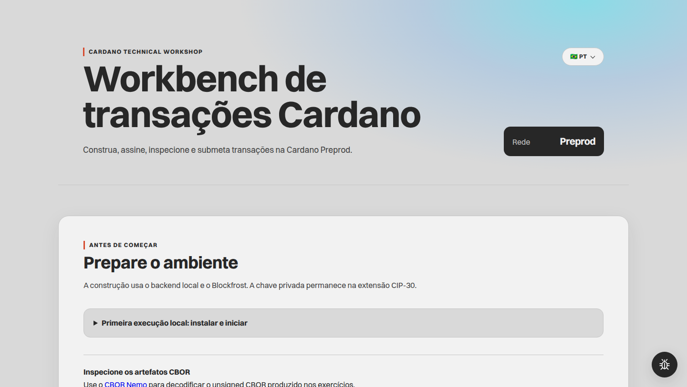

# cardano-technical-workshop

[English version](README.en.md)

Workbench full-stack em TypeScript para construir transações Cardano pela API e assinar com uma wallet CIP-30. Uma adaptação permite deploy estático usando a mesma lógica Cardano no navegador.



A fronteira de custódia é explícita:

- no modo full-stack, a API consulta a Cardano Preprod, constrói transações e submete via Blockfrost;
- no modo estático, o navegador executa essas operações com os mesmos builders e validadores;
- a extensão CIP-30 assina no navegador sem expor a chave privada;
- a Workbench valida e exibe unsigned CBOR, witnesses, signed CBOR, transaction hash e inclusão em bloco.

## Requisitos

- Node.js 20.19.0 ou superior para desenvolver, gerar os builds e executar a API; o site estático publicado não exige Node no cliente;
- Google Chrome ou Chromium disponível como `google-chrome` ou por `CHROME_BIN`, além de `gio` para descartar o perfil temporário do smoke test de navegador;
- projeto Blockfrost em Cardano Preprod;
- wallet CIP-30 configurada em Preprod;
- tADA em pelo menos um UTxO da wallet usada para construir transações;
- segunda wallet com outra chave de pagamento para o exercício multisig.

O identificador de rede CIP-30 diferencia mainnet de testnet, mas não diferencia Preprod de Preview. A seleção de Preprod precisa ser conferida na extensão.

## Desenvolvimento full-stack

Este é o modo padrão e o caminho explicado no [passo a passo](passoapasso.md).

```bash
npm ci
cp .env.example .env
# Configure um projeto Blockfrost Preprod em .env.
npm run dev
```

Os scripts `dev`, `server`, `start` e `address` carregam o `.env` da raiz pelo Node, sem comandos de shell. Crie o arquivo antes de executá-los. Variáveis já definidas no ambiente têm precedência sobre o arquivo.

Abra <http://127.0.0.1:5173>. O comando inicia o frontend Vite e a API Express, disponível em <http://127.0.0.1:8787/api/health>. O Vite encaminha `/api` para o backend. `BLOCKFROST_PROJECT_ID` permanece no ambiente do servidor; o frontend não pede, lê nem envia uma chave Blockfrost do navegador neste modo. A API não recebe a seed ou chave privada da wallet.

Os adapters em `apps/web/src/workshop.ts` mantêm o mesmo contrato para a interface. No modo full-stack, usam as rotas de `apps/api/src/server.ts`; no estático, chamam diretamente os builders e validadores de `packages/cardano/`. A escolha é feita no build, sem fallback automático entre modos.

## Publicação

### Full-stack

```bash
npm run build
npm run server
```

Com o `.env` configurado, o Express serve o frontend de `dist/` e as rotas `/api` na mesma origem. O bind padrão é `127.0.0.1:8787`; use um proxy HTTPS para exposição externa. Antes de publicar uma API aberta, configure controle de acesso e limites de requisição para proteger a cota Blockfrost. Não publique `.env` nem arquivos de seed. Se a hospedagem injeta as variáveis sem um arquivo `.env`, inicie com `node --import tsx apps/api/src/server.ts`.

### Estática

```bash
npm run build:static
```

Publique **somente `dist-static/`** no Vercel, GitHub Pages ou outro servidor estático. Esse diretório é separado de `dist/`, para que um build não substitua o outro. Os assets usam URLs relativas e permitem hospedagem em subdiretório. Nenhum backend de aplicação ou segredo de build é necessário. Para desenvolver nesse modo, use `npm run dev:static`.

No site estático, clique em **API key** e informe sua própria chave Blockfrost Preprod. Ela fica sem criptografia no `localStorage` desta origem e é enviada como header ao endpoint fixo de Preprod. Scripts desta origem podem lê-la. Não use uma credencial compartilhada da CF e remova a chave em dispositivos compartilhados. O prompt permite trocar a chave; vazio remove e Cancelar preserva. A troca mantém os artefatos e repete a verificação de prontidão.

Nunca informe seed phrase ou chave privada da wallet. As operações de rede continuam exigindo internet; deploy estático não significa operação offline.

[CBOR Nemo](https://cbor.nemo157.com/) é uma ferramenta externa de inspeção. Prefira unsigned CBOR. Nunca envie seed phrase, chave privada ou credencial Blockfrost; quem obtiver um signed CBOR válido poderá submetê-lo.

## Dinâmica participante-led

A Workbench é o guia operacional autoritativo. Depois de uma introdução curta, o participante deve conseguir:

1. verificar Blockfrost, wallet, rede e saldo;
2. entender objetivo, entradas, saída esperada e efeito de cada exercício;
3. seguir somente a próxima ação habilitada;
4. reconhecer build, assinatura, merge, submissão e inclusão;
5. corrigir um erro e tentar novamente sem perder o último checkpoint válido;
6. reiniciar apenas o exercício atual;
7. restaurar campos e artefatos preservados na mesma aba;
8. consultar o trecho de código real correspondente a cada etapa.

A sessão usa `sessionStorage`. Ela preserva endereços, CBOR e witnesses na aba atual, mas nunca armazena a chave privada ou o objeto CIP-30. Depois de recarregar a página, a wallet precisa ser conectada novamente. O script address e a lista de UTxOs do setup multisig não são persistidos; gere, confira e selecione esses dados novamente antes de um novo lock ou unlock.

## Idioma

O seletor `Idioma` da própria Workbench alterna entre português do Brasil e inglês sem recarregar a página. Português do Brasil (`pt-BR`) é o padrão, independentemente do idioma do navegador. A preferência explícita fica separada no `localStorage`, na chave `cardano-technical-workshop.locale.v1`, enquanto inputs, progresso e artefatos das transações permanecem no `sessionStorage`, na chave `cardano-technical-workshop.session.v1`.

A troca atualiza textos visíveis, nomes acessíveis, anúncios, formatação dependente de locale, `html.lang` e mensagens de erro estruturadas. No modo full-stack, as chamadas enviam `Accept-Language`, e a API responde com `Content-Language` e referências de mensagens; no estático, a localização ocorre no navegador.

A troca não reconstrói, assina, combina, submete, reinicia nem altera o estado das transações, o estado da sessão, os inputs, os artefatos ou a autorização da wallet. Um reload restaura separadamente a preferência de idioma e a sessão preservada, mas a wallet CIP-30 continua desconectada até uma nova autorização do participante.

## Exercícios

1. Pagamento simples.
2. Pagamento com metadata no label 674.
3. Multisig 2-de-2, com lock, seleção de UTxO, handoff de CBOR e unlock.
4. Native Asset em dois exemplos:
   - 4A: emissão didática de `EAC-WORKSHOP-001`, aposentadoria parcial por burn e metadata raw no label `65536` da faixa private use;
   - 4B: media token com metadata de apresentação CIP-25 no label `721`.

No modo full-stack, cada pipeline mantém o seguinte contrato. No estático, o browser executa as operações atribuídas à API:

```text
API constrói unsigned tx
wallet CIP-30 produz witness
browser valida e anexa witness
participante revisa o efeito
API submete signed tx ao Blockfrost
Workbench verifica inclusão na Preprod
```

Cada cartão de etapa oferece `Ver código`. O modal identifica exercício, etapa, arquivo e intervalo de linhas e mostra um trecho extraído do código-fonte atual com realce sintático TypeScript. Builds limpos ligam o trecho ao commit Git exato. Com alterações locais sem commit, o caminho continua visível, mas não recebe um link remoto que representaria outro código. Abrir ou fechar o modal não altera inputs, progresso, artefatos nem sessão.

O hash é determinístico e pode ser calculado localmente antes da submissão. Uma resposta de sucesso do Blockfrost confirma a aceitação para submissão. Se a resposta se perder, a Workbench preserva o hash como `resultado desconhecido`, permite consultar inclusão e só repete a submissão por ação explícita. Um `404` na consulta significa apenas que o Blockfrost ainda não indexa o hash; não confirma rejeição nem aceitação. O exercício só mostra conclusão quando o Blockfrost informa inclusão em um bloco. Essa inclusão não deve ser descrita como finalidade irreversível.

## Efeitos na Preprod

- Pagamento transfere tADA e paga taxa.
- Metadata transfere tADA e publica conteúdo visível na blockchain.
- Multisig lock move tADA para um script que exige duas chaves distintas. Uma configuração incorreta pode deixar o saldo inacessível.
- Multisig unlock consome o UTxO escolhido, envia o valor definido ao destino e devolve o troco ao script. A inclusão conclui uma rodada, não a recuperação total do saldo. Para mover o restante, reinicie o unlock, liste o novo UTxO e repita com as duas wallets.
- O exemplo EAC cria `1000000` unidades-base sintéticas de `EAC-WORKSHOP-001`. Com `decimals: 3`, a Workbench exibe `1.000,000 EAC`. Essa convenção de exibição não altera a quantidade inteira registrada no ledger. O saldo permanece na wallet conectada.
- A emissão anexa `methodology_hash`, `assurance_hash` e `evidence_root` no label `65536`. A aposentadoria queima `125000` unidades-base, mantém `875000` no output e anexa `declaration_hash` e `delivery_reference_hash` no mesmo label. Todos os hashes são sintéticos. O label private use não torna os dados confidenciais.
- A policy EAC é estável e exige a chave da wallet. Ela não valida metadata, não limita a oferta nem comprova alegações externas. A validade de aproximadamente três horas pertence a cada transação construída, não à policy.
- O exemplo CIP-25 cria unidades de um media token, usa ao menos 5 tADA no output e possui policy com validade de aproximadamente três horas.

Use wallets descartáveis e valores de testnet durante validação.

## CLI de apoio

A CLI Node separada lê `CARDANO_NETWORK=preprod`, `BLOCKFROST_PROJECT_ID` e, para assinar, `.seedphrase` ou `WALLET_MNEMONIC`. Configure essas variáveis no `.env` local a partir de `.env.example`; os scripts da CLI carregam o arquivo automaticamente. Nunca publique essas credenciais. O site não importa esse código de filesystem e seed.

```bash
npm run start -- address
npm run start -- send-ada addr_test... 100000000
npm run start -- build-cbor addr_test... 100000000
npm run start -- build-cbor-metadata addr_test... 100000000 "Hello, Cardano!"
npm run start -- multisig-info second_signer_addr_test...
npm run start -- lock-multisig second_signer_addr_test... 10000000
npm run start -- build-multisig-partial second_signer_addr_test... destination_addr_test... 2000000 txhash#index
npm run start -- mint-cip25 recipient_addr_test... MyLittleToken 10 "My Little Token" ipfs://... "Description"
npm run start -- sign-cbor <unsigned_tx_cbor>
```

O CLI `sign-cbor` pode produzir o segundo witness do unlock. O unsigned CBOR é o objeto compartilhado; cada signer devolve somente seu witness.

## Validação

```bash
# descobre recursivamente todos os arquivos *.test.ts
npm test
npm run build
# com npm run dev ativo em outro terminal
npm run test:browser
# para testar a variante estática com npm run dev:static ativo
npm run test:browser:static
# ou gere e teste os dois builds em servidores isolados
npm run test:browser:isolated
```

Os testes de Node cobrem validação de requests, dispatch básico da CLI, construção local das transações com respostas Blockfrost controladas, schema raw da emissão EAC, policy EAC estável, rede e valores, signers multisig distintos, inspeção de CBOR importado, prontidão Blockfrost, consulta de inclusão, submissão ambígua, hash divergente, resumos derivados da transação, validade dos mints, erros HTTP, progressão do pipeline, invalidação de artefatos, retry, restauração de sessão e localização.

O smoke de navegador cobre os dois modos: PT/EN, acessibilidade, layout, restauração e o caminho usado para construir um pagamento. A variante estática testa também a API key e a recuperação após falha do provedor, sem backend. A variante full-stack verifica chamadas `/api`, idioma e ausência de credencial Blockfrost no browser. Os testes usam respostas controladas e uma wallet simulada, sem assinar ou submeter transações reais. A validação real exige uma wallet CIP-30 financiada em Preprod e autorização explícita do participante.

## Roteiro de facilitação

[`passoapasso.md`](passoapasso.md) contém o modelo mental, perguntas de discussão e notas para o facilitador. Ele não duplica a sequência de botões da interface. A [versão em inglês](passoapasso.en.md) também está disponível.

## Licença

MIT.
